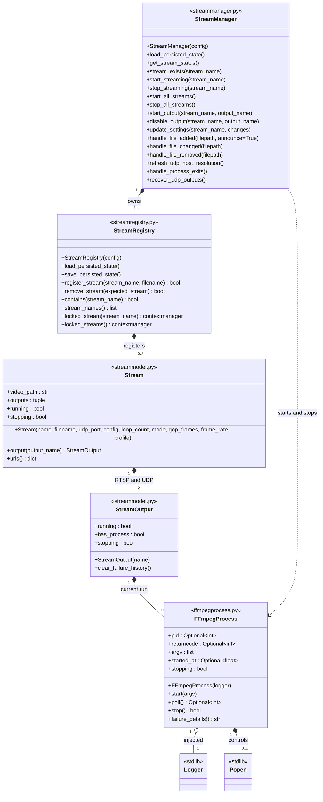
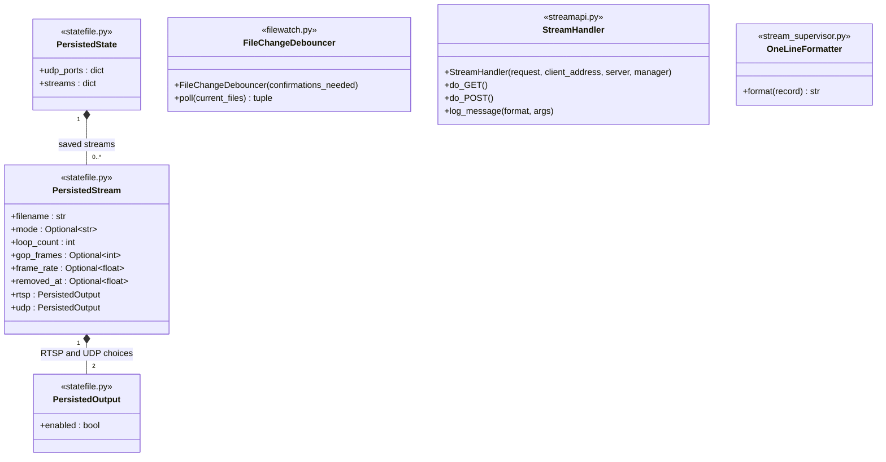

# Plan: reduce argument complexity and improve encapsulation

> Historical architecture and measurements: use [Autostream: simplified
> responsibility-driven design](responsibility-driven-design.md) for the current
> plan. It assigns all lifecycle changes and persistence to the existing
> supervisor loop, using Popen for process facts. The interfaces, concurrency
> guidance, and projected scores below are superseded, including generation
> checks and shared lifecycle locks. Preserve the scoring discussion and baseline
> measurements as context; do not implement the historical design below.

Status: historical record. The concurrent implementation attempt was rejected;
the subsequently approved simplified RDD design is implemented in the working tree.

Selected design: Approach A's narrow inputs and pure decision functions, plus
registry encapsulation and a logger-injected FFmpegProcess class. Use
subprocess.Popen inside that class. StreamOutput does not own process lifecycle,
command construction, or API response formatting. The broader object-oriented
Approach B below is historical and is not the selected implementation.

Keep the current HTTP API, state-file format, codec decisions, and lifecycle
behavior. The benefit of encapsulation should be stronger ownership and fewer
exposed internals, not just fewer explicit arguments.

## Accepted terminology and file layout

These names supersede the provisional names in the historical comparisons below.
Renaming alone changes none of the argument, cohesion, coupling, or complexity
scores. Apply the names consistently to imports, internal callers, tests, build
file lists, and architecture documentation when implementation is authorized.

| Existing or earlier proposed name | Accepted name | Precise meaning |
|---|---|---|
| Output | StreamOutput | One stream's RTSP or UDP output record, including desired state and failure history |
| FileProfile | MediaProbeResult | Media information obtained by probing a source file |
| EncodeSpec | FFmpegCommandSettings | Decisions used to construct an FFmpeg command, including playback and destinations |
| OutputAvailability | OutputStartBlockers | Permanent failure or transient waiting reason that prevents starting an output |
| UdpDestination | UdpLaunchConditions | Host, configured port range, and cached hostname-resolution result; not one endpoint |
| output_reachable | udp_host_resolves | Whether the configured UDP hostname resolves, not whether a receiver is reachable |
| refresh_output_reachable() | refresh_udp_host_resolution() | Refresh the cached hostname-resolution result |
| claim_slot() | register_stream() | Register a stream, reject name collisions, and restore retained settings |
| cleanup_dead_processes() | handle_process_exits() | Handle expected completion, deliberate stops, and failures needing restart |
| reset_health() | clear_failure_history() | Clear the crash count and last failure |
| occupied | has_process | A process is still associated with this output, including while stopping |
| handle_create() | handle_file_added() | Handle a source file appearing |
| handle_modify() | handle_file_changed() | Handle a source file changing |
| handle_delete() | handle_file_removed() | Handle a source file disappearing |
| streams.py | streammanager.py | Application coordination |
| streampolicy.py | streamdecisions.py | Pure encoding and launch decisions |
| streamstatus.py | streamresponses.py | API response construction, as verified in the current module |

Keep StreamRegistry, BitrateLimit, and FileChangeDebouncer. Use FFmpegProcess
for the process wrapper. Distinguish a stream, its protocol-specific outputs,
their destination addresses, and the subprocesses serving them. Existing HTTP
routes, JSON keys, environment variables, and persisted keys are not renamed
by this internal terminology change.

| File after refactoring | Classes and responsibilities |
|---|---|
| appconfig.py | Config: startup configuration and validation |
| streammodel.py | Stream and StreamOutput: identity, requested settings, output choices, and application state |
| streamregistry.py | StreamRegistry: registration, retained settings, UDP allocation, and synchronized access |
| streammanager.py | StreamManager: file events, user requests, restart decisions, and lifecycle coordination |
| streamdecisions.py | BitrateLimit, UdpLaunchConditions, OutputStartBlockers: immutable values used by pure decision functions |
| ffmpegcmd.py | MediaProbeResult and FFmpegCommandSettings; media probing and command construction functions |
| ffmpegprocess.py | FFmpegProcess: Popen lifecycle, bounded shutdown, and process diagnostics using an injected logger |
| streamresponses.py | Functions constructing stream and output API responses |
| statefile.py | PersistedOutput, PersistedStream, PersistedState and JSON storage |
| streamapi.py | StreamHandler and HTTP transport |
| filewatch.py | FileChangeDebouncer and source file watching |
| stream_supervisor.py | OneLineFormatter, logging configuration, composition, and polling loop |

This keeps twelve application modules. socket_memory.py remains a separate
diagnostic. Record constructor and stored-field counts will be remeasured after
process ownership is moved; the old Output field count is not a commitment to
duplicate process state in StreamOutput and FFmpegProcess.

## Selected ownership boundaries

### Process lifecycle and logging

Proposed use:

```python
process = FFmpegProcess(logger)
process.start(argv)
process.stop()
```

Inject a configured logger once, rather than passing log_path through recurring
process calls. Keep logging configuration at startup. The wrapper owns its Popen
handle and process lifecycle, including terminate/wait/kill escalation. It retains
ownership when a process cannot be reaped and must not permit a replacement to
reuse that process's destination prematurely. The manager decides whether an
exited stream should restart or is complete.

The logger records application diagnostics. FFmpeg stdout/stderr capture still
needs an explicit implementation: a Logger is not a subprocess file descriptor
and does not provide log-tail retrieval. Resolve capture, bounded diagnostic
retention, and any reader-thread lifecycle before implementing this boundary.
Preserve per-output diagnostics and debug visibility; do not infer a path from
arbitrary logger handlers or hide global configuration in the wrapper. Count any
additional dependencies and stored capture state in the final argument audit.

At the application boundary, start_streaming(stream_name) describes starting a
stream's enabled destinations; FFmpegProcess.start(argv) starts one subprocess.
These are separate operations, not interchangeable names for one helper.

### Registry encapsulation

StreamRegistry owns its dictionaries, registration, retained settings, port
assignments, and lock. Expose complete registration/removal operations, copied
name lists, and short guarded access to a Stream. This may expose the Stream
record intentionally; it does not expose the registry's storage or lock fields.
StreamManager must no longer access registry.streams or registry.lock directly.

Keep probing, hostname resolution, and process waits outside guarded access.
After I/O, verify that the original stream/output/process still owns the
operation before changing state. Preserve the existing synchronization model
behind the registry boundary initially; do not add per-stream locks unnecessarily.

### Narrow values and pure functions

- BitrateLimit: text and bits_per_second, two stored fields.
- UdpLaunchConditions: host, first_port, last_port, udp_host_resolves, four fields.
- OutputStartBlockers: failure_reason and waiting_reason, two optional fields
  with at most one populated.

Keep these records passive. Keep bitrate selection, launch checks, command
construction, and response construction as functions with narrow inputs.
Continue using the validated settings mapping intact, preserving absent keys
versus explicit automatic values and one atomic settings update.

StreamOutput retains application output state and failure history. It does not
launch or stop subprocesses, select codecs, allocate ports, or format responses.
Define the exact field split with FFmpegProcess before implementation so there
is one authoritative copy of process state.

## Proposed public interface in UML

This is the proposed interface, not implemented code. There are seventeen
application classes across twelve files. The diagrams separate lifecycle,
value records, and supporting infrastructure for readability. Logger and Popen
are standard-library dependencies and are not additional application classes.
The diagram labels identify the files containing each class.

UML notation: `+` means public, a filled diamond means ownership, an open
diamond means a shared reference, and a dashed arrow means a dependency.
Methods omit `self`. All attributes in the lifecycle diagram are read-only
properties without public setters.
Dataclass-generated equality/repr methods and inherited framework methods are
omitted. Names introduced in this interface beyond the accepted rename table
remain proposals, including locked_stream and failure_details.

### Lifecycle and application coordination



The Stream constructor is shown without defaults in the diagram. Its exact
proposed signature, including keyword-only settings, is:

```python
Stream(name, filename, udp_port, *, config,
       loop_count=-1, mode=None, gop_frames=None,
       frame_rate=None, profile=None)
```

RTSP and UDP records are created internally. handle_file_added has the exact
signature `handle_file_added(filepath, *, announce=True)`; announce controls
the file-added message during initial discovery.

StreamManager.start_output enables and starts or restarts one output;
disable_output stops it and records that supervision should leave it stopped.
Launch helpers, probe refresh, and restart mechanics become private methods.

StreamRegistry.remove_stream verifies object identity before removal and retains
the stream's settings. This prevents a stale operation from removing a newer
registration with the same name. The explicit object argument has a field-based
cost under the agreed metric and is not treated as a one-point identifier.
locked_stream yields Stream or None; locked_streams yields a tuple of records.
Access to mutable records occurs only inside these short contexts. A retained
reference outside a context may be used as an identity token, not for unguarded
mutation. Port allocation and retained-record conversion remain private.

FFmpegProcess.stop returns whether the subprocess exited after bounded shutdown.
poll returns the exit code or None while running. Define pre-start handling
explicitly when implementing the lifecycle. A new run uses a new FFmpegProcess
instance; do not recycle a wrapper while another operation may retain its
identity. failure_details returns diagnostic text, leaving API response assembly
to streamresponses.py. Capturing subprocess stdout/stderr remains an unresolved
implementation detail; Logger injection alone does not supply capture.

StreamOutput stores desired enabled state, completion, failure history, and its
process association. Process arguments, timing, and stopping state come from
FFmpegProcess rather than duplicate fields. clear_failure_history clears the
crash count and last failure; it does not start or stop a process.

### Configuration and immutable value records

These records retain generated constructors for their declared fields. Config
is normally constructed through from_env; max_video_bps is derived and excluded
from its generated constructor. Optional values and existing defaults follow
the current declarations unless explicitly shown otherwise below.

```mermaid
classDiagram
    direction TB

    class Config {
        <<appconfig.py>>
        +hostname : str
        +rtsp_port : int
        +hls_port : int
        +api_port : int
        +log_level : str
        +output_host : str
        +udp_base_port : int
        +udp_last_port : int
        +max_video_bitrate : str
        +videos_dir : Path
        +state_path : Path
        +ffmpeg_log_dir : Path
        +max_video_bps : Optional~int~
        +from_env(environ=None) Config$
        +show_ffmpeg_output : bool
    }

    class BitrateLimit {
        <<streamdecisions.py>>
        +text : str
        +bits_per_second : Optional~int~
        +BitrateLimit(text, bits_per_second)
    }

    class UdpLaunchConditions {
        <<streamdecisions.py>>
        +host : str
        +first_port : int
        +last_port : int
        +udp_host_resolves : bool
        +UdpLaunchConditions(host, first_port, last_port, udp_host_resolves)
    }

    class OutputStartBlockers {
        <<streamdecisions.py>>
        +failure_reason : Optional~str~
        +waiting_reason : Optional~str~
        +OutputStartBlockers(failure_reason=None, waiting_reason=None)
    }

    class MediaProbeResult {
        <<ffmpegcmd.py>>
        +video_codecs : Optional~tuple~
        +audio_codecs : Optional~tuple~
        +audio_copyable : bool
        +pix_fmt : Optional~str~
        +bitrate_bps : Optional~int~
        +frame_rate : Optional~float~
    }

    class FFmpegCommandSettings {
        <<ffmpegcmd.py>>
        +video_path : str
        +stream_name : str
        +loop_count : int
        +gop_frames : int
        +frame_rate : Optional~float~
        +passthrough : bool
        +audio_copy : bool
        +bitrate_cap : str
        +rtsp_port : int
        +udp_target : Optional~str~
        +encoder_label : str
    }
```



Config.from_env is a class method; Mermaid's `$` classifier indicates that it
is called on the class. show_ffmpeg_output and encoder_label are read-only properties.
The other records are passive values, not services.
OutputStartBlockers permits at most one populated reason.

### Persistence, HTTP, file watching, and logging

Persisted records retain their existing generated constructors and defaults.
They describe saved choices, not live processes. StreamHandler's HTTP framework
callbacks and OneLineFormatter.format retain their framework-required names.



StreamHandler's constructor accepts the standard HTTP handler arguments and a
keyword-only manager dependency. log_message retains the actual variadic
signature `log_message(format, *args)`. JSON/HTML sending and route parsing are
private helpers. OneLineFormatter inherits the standard formatter constructor.
No custom interface base classes are proposed.

### Public module-level functions

These functions have no independent object lifecycle and remain module-level
interfaces. They are listed separately so the class diagram does not invent
classes solely to contain functions. Private helpers are omitted.

| File | Public functions |
|---|---|
| appconfig.py | parse_bitrate(text) |
| streammodel.py | is_ignored(path), stream_name_for(path) |
| streamdecisions.py | default_mode(video_codecs), passthrough_eligible(video_codecs), bitrate_cap_for(source_bps, limit), command_settings(stream), udp_start_blockers(udp_port, conditions) |
| ffmpegcmd.py | probe_file(video_path), natural_gop_frames(frame_rate), build_argv(settings, output_name) |
| streamresponses.py | get_stream_status(streams, udp_conditions) |
| statefile.py | load_state(path), save_state(path, state) |
| streamapi.py | parse_settings(query), serve(port, manager) |
| filewatch.py | watch(directory, ignore, poll_interval=2, quiet_period=4) |
| stream_supervisor.py | configure_logging(log_level), wait_for_mediamtx(rtsp_port), main() |

The module-level get_stream_status formats records; the manager method acquires
guarded access and delegates to it. Configuration requirements and filename
normalization become private helpers behind from_env and stream_name_for.

Naming recommendations for newly introduced interfaces: locked_stream makes
the held-lock contract clearer than access_stream; failure_details exposes the
diagnostic purpose without coupling callers to a particular stderr-tail capture
implementation. The exact capture design and lifecycle state transitions must
be resolved before the full refactor is approved for implementation.

## Selected implementation sequence and validation

Implementation starts only after approval of the full refactor.

1. Finalize FFmpeg stdout/stderr capture and the process/output field split.
   Record constructor inputs, receiver fields, and the scoring convention for
   Logger and other third-party objects before making quantitative claims.
2. Apply the accepted internal names, imports, test references, build file
   lists, and architecture documentation consistently.
3. Introduce FFmpegProcess with logger injection and the existing bounded
   shutdown behavior. Preserve process identity checks and stuck-process
   ownership, keeping the restart decision in StreamManager.
4. Encapsulate the registry's storage and locking behind complete operations
   and short guarded access. Preserve collision handling and port retention.
5. Introduce the narrow value records, reuse command settings during response
   construction, and pass settings edits as one validated mapping.
6. Run the existing tests and focused regressions for stop during probing,
   replacement during shutdown, stuck processes, finite completion, output
   enablement, UDP hostname recovery, settings updates, and port retention.
   Compare API responses, commands, and persisted state with the baseline.
7. Rerun argument scoring, pydeps, cohesion, and Radon. Report constructors,
   forwarding calls, receiver fields, and direct representation access alongside
   explicit argument costs. Target zero external registry dictionary/lock
   accesses and zero import cycles; do not promise unmeasured future scores.

Build and deployment are separate from this planning approval. Do not start the
container as part of the naming update.

## Historical alternatives and measurement baseline

The following sections preserve the original A/B analysis and baseline figures.
Their old type and file names identify the design at the time of measurement.
They are not implementation instructions where they conflict with the selected
design above. In particular, the log_path-based A process API and B's broad
Output ownership, behavior-bearing records, and 9-argument/14-point projection
have been superseded. Neither original total is a prediction for the selected
hybrid. Logger construction/capture costs and the final receiver fields remain
to be measured; an injected Logger must not be assigned an arbitrary one-point
weight.

## Scoring contract

The following interpretation is provisional pending confirmation of the scoring
question asked during planning:

- Count explicit arguments at project-owned Python call boundaries. Each scalar
  costs 1 point. Positional and keyword arguments count equally.
- A dictionary costs one point per top-level key, capped at 5. Class instances
  cost one point per stored field, including private and derived stored fields.
  These weights replace the scalar weight; they are not added to it.
- Expand class fields one level only. Properties and methods are not stored
  fields. Do not recursively expand a nested object in this primary score.
- A homogeneous collection costs 1 point. For a heterogeneous tuple/list, use
  the sum of the element weights; this is an explicit additional convention.
- Exclude implicit self/cls from the primary score. Measure receiver state
  separately so converting a free function to a method cannot be mistaken for
  eliminating the data it needs.
- Count only supplied arguments at actual call sites. For the interface table,
  use the stated representative call, including all four settings when updating
  settings. Omitted defaults do not count. An explicit None still costs 1.
- Expanding **settings counts the supplied keyword values individually. Passing
  settings as a dictionary counts its keys, up to 5. A four-key update therefore
  has the same weight either way.
- Constructor calls are calls and must be counted. Returning an object has no
  argument score until it is passed onward. Count helpers and forwarding calls
  when comparing an entire operation, not only the outermost method.
- Do not substitute an opaque third-party instance, such as subprocess.Popen,
  with a made-up one-point weight. Such calls need an explicit type policy or
  are marked unscored. Proposed string paths are scalars; existing Path objects
  and OS handles are not silently treated as one-field project classes.

The quantitative comparisons below cover identified project-owned interfaces,
not every stdlib invocation or a runtime-frequency-weighted application total.
They do not use a package's cohesion percentage as an argument score.

### Avoid misleading improvements

Do not replace typed records with dictionaries to exploit the five-point cap.
Do not wrap a large object in a homogeneous list to make it cost one point.
Do not move arguments into a module global, closure, or arbitrary context object.
Track constructor costs, stored receiver fields, and cross-object field access
alongside the requested score. Stream collections already score only 1, even
though processing each member can require many high-cost calls.

## Current inputs

Counts verified against the working tree's declarations and stored assignments:

| Class | Stored fields | Cost when explicitly passed |
|---|---:|---:|
| Config | 13 | 13 |
| Stream | 11 | 11 |
| Output | 9 | 9 |
| FileProfile | 6 | 6 |
| EncodeSpec | 10 | 10 |
| StreamManager | 4 | 4 |
| StreamRegistry | 6 | 6 |
| PersistedStream | 8 | 8 |
| PersistedState | 2 | 2 |

Examples: Config includes max_video_bps even though it is init=False. Output's
running/occupied properties do not add fields. PersistedState's two dictionaries
are two fields under the one-level convention; their contents are not free of
complexity merely because this score does not expand them.

## Approach A: narrow interfaces while keeping the current orchestration

### 1. Pass the process layer only its actual inputs

Change the FFmpeg launch boundary from
`launch_output(argv, stream_name, output_name, config)` to
`launch_output(argv, log_path, show_output)`, with a string log_path.
Compute the output's path where stream/output identity and configuration already
meet. Keep stream-level logging in the manager. Avoid passing both identity and
its already-derived path through multiple helpers.

Likewise use `ffmpeg_death_reason(log_path, show_output)` and
`_ffmpeg_tail(log_path)`. Remove `_ffmpeg_log_path` from the diagnostic call chain.
This is a real reduction in the information the process layer receives: it no
longer sees API ports, UDP allocation bounds, bitrate settings, or video roots.

### 2. Give policies narrowly defined values

Use these small immutable value records; names are provisional:

- BitrateLimit: text and bits_per_second (2 fields). Both values already exist
  in Config. Construct the record once, not on each status/launch call.
- UdpDestination: host, first_port, last_port, reachable (4 fields). Construct
  the initial value at startup and replace/update it when reachability changes.
- OutputAvailability: failure_reason and waiting_reason (2 optional strings,
  at most one populated). Construct it at the output availability decision.

Use `bitrate_cap_for(source_bps, limit)` and
`udp_launchable(udp_port, destination)`. The latter produces availability without
receiving a complete Stream. These records represent specific concepts rather
than a general-purpose parameter bag. Dictionary and class versions would have
identical point weights at these sizes; prefer explicit typed fields.

Keep encoding selection based on Stream initially. Splitting it into many
unrelated scalar parameters would increase arity and can increase total points.

### 3. Separate output state from stream-level presentation

Change `_output_state(stream, output, reachable)` to
`_output_state(output, availability)`.

Change `_output_status(stream, output, reachable)` to
`_output_status(output, availability, argv)`.

The stream-level presenter obtains the encoding specification once and computes
preview commands from it. It supplies the running process's recorded argv when
appropriate. This avoids each output helper deriving commands and rereading all
stream configuration. Remove the redundant `default_argv` forwarding path once
its callers use the existing specification directly.

Preserve state precedence: deliberately stopped first; missing port before
running; completion before transient reachability failure; transient waiting
before crash-restart/error presentation. Keep no-video and launch diagnostics.

### 4. Pass existing settings edits as one mapping

Use `update_settings(stream_name, changes)` with the already validated settings
mapping instead of expanding **settings into four keyword values. Maximum arity
falls from 5 to 2; maximum weighted cost stays 5. Missing keys still mean retain
the old setting, and an explicit None still means automatic behavior.

Keep one atomic Apply and at most one restart per running output. Do not split
this into four setters merely to lower per-call argument counts.

### 5. Preserve boundaries that are already useful

Keep the ten-field EncodeSpec as the explicit encoding/FFmpeg boundary in A.
Keep probing, storage, file watching, and HTTP handling separate. Keep the
process handle inside the lifecycle code where practical; score any remaining
third-party-handle boundary separately rather than inventing its field count.

A intentionally does not claim to resolve direct manager/registry dictionary
access. That remains the ownership problem addressed in B.

## Approach B: make the state owners responsible for behavior

Apply A's narrow configuration concepts, then replace repeated data transfers
with operations on the owning objects. This is a proposed design, not an
implemented class graph or a measured future cohesion score.

### Object responsibilities

- StreamRegistry owns its maps, name collisions, retained settings, port
  assignments, and synchronization. Public operations handle lookup, claim,
  removal, and safe iteration/snapshots. Callers do not access its dictionaries
  or lock field directly.
- Stream owns stream identity, saved settings, the last probe, and its outputs.
  It creates its encoding specification, handles a single settings update, and
  coordinates output choices. It exposes operations rather than writable fields
  for the manager to edit.
- Output owns its process, enabled/completed/stopping state, crash history, and
  log destination. It provides launch(argv), stop(), state(availability),
  status(availability, argv), and death_reason(). It must retain process identity
  checks and refuse to reuse a destination while a process is still stopping.
  Adding log_path and show_output to today's Output gives 11 stored fields; these
  fields count if an Output is explicitly passed anywhere.
- EncodeSpec remains an immutable ten-field record and gains
  build_argv(output_name). Command construction is a behavior over its own data;
  the complete specification no longer needs to be sent into a free function.
- BitrateLimit owns its two values and exposes cap_for(source_bps).
- UdpDestination owns reachability and the configured range, and exposes
  launchable(udp_port). OutputAvailability remains a two-field result.
- StreamManager becomes an application coordinator: resolve a stream through
  the registry and invoke its operation. HTTP routes continue to use this facade.
  The facade's update_settings(stream_name, changes) still costs 5 at full size;
  forwarding changes into a Stream method is an additional 4-point call.

Construct the narrow policy objects at the composition boundary and give each
owner only the policies it uses. All constructor inputs and any later service
object transfers must be included in the final implementation's score. Do not
infer that a service reference costs one point simply because it is an object.

### Keep concurrency behavior explicit

Registry membership/port operations and each stream's lifecycle need clearly
defined ownership. If separate registry and stream locks are used, establish a
single lock ordering and a retired/generation check for removed slots. Prefer
preserving the current synchronization model initially behind the new boundary.
Never hold state locks across probing, DNS, or process waits. After I/O, verify
that the slot/output still owns the operation before changing its state.

Do not replace direct dictionary access with a long chain of trivial forwarding
methods. Each added call has a cost under the requested metric, as well as a
maintenance cost. The new API must express complete operations.

### Provisional naming choices

These are alternatives for later implementation review, not terminology changes:

| Responsibility | Alternatives | Recommendation and tradeoff |
|---|---|---|
| Process-owning output | Output / OutputProcess / OutputController | Keep Output: least churn; OutputProcess is narrower but understates enabled/completed state; OutputController emphasizes orchestration but adds another abstraction. |
| Immutable command description | EncodeSpec / EncodingPlan / FFmpegCommand | Keep EncodeSpec: existing terminology; EncodingPlan emphasizes decisions; FFmpegCommand incorrectly suggests argv already exists. |
| UDP destination policy | UdpDestination / UdpTarget | UdpDestination communicates host/range/reachability; UdpTarget is shorter but can be confused with one concrete host:port. |

## Projected interface metrics

Each cell is **explicit argument count / weighted points**. Count the full
settings update. The B process/status calls are methods on the Output that owns
the data. A's records have exactly the fields specified above.

| Operation and current interface | Current | A | B |
|---|---:|---:|---:|
| bitrate_cap_for(source_bps, config) | 2 / 14 | 2 / 3 | 1 / 1 |
| process launch_output(argv, stream_name, output_name, config) | 4 / 16 | 3 / 3 | 1 / 1 |
| ffmpeg_death_reason(stream_name, output_name, config) | 3 / 15 | 2 / 2 | 0 / 0 |
| udp_launchable(stream, reachable) | 2 / 12 | 2 / 5 | 1 / 1 |
| _output_state(stream, output, reachable) | 3 / 21 | 2 / 11 | 1 / 2 |
| _output_status(stream, output, reachable) | 3 / 21 | 3 / 12 | 2 / 3 |
| build_argv(spec, output_name) | 2 / 11 | 2 / 11 | 1 / 1 |
| encode_spec(stream) | 1 / 11 | 1 / 11 | 0 / 0 |
| manager.update_settings(name, all four edits) | 5 / 5 | 2 / 5 | 2 / 5 |
| Sum of these nine interface samples | **25 / 126** | **19 / 63** | **9 / 14** |

For this fixed sample, A reduces explicit slots by 24% and weighted points by
50%. B reduces slots by 64% and weighted points by 88.9%. These are interface
budget projections, not whole-application savings or runtime measurements.
They exclude setup and additional calls; those cannot be omitted from acceptance
measurement. In particular, the B settings facade forwards the four-key mapping,
so its complete route may cost more despite the unchanged outer score.

### Construction and receiver costs

- BitrateLimit construction costs 2 points; UdpDestination construction costs 4.
  Every new OutputAvailability construction costs 2. Reusing an unchanged value
  avoids reconstruction, not the cost of explicitly passing it again.
- Existing Output construction supplies its name: 1 point. B's proposed
  Output(name, log_path, show_output) costs 3, adding 2 points per output at setup.
- EncodeSpec construction still supplies ten scalar decisions: 10 points in all
  approaches. Its build_argv method saves passing the record onward; it does not
  remove its ten pieces of state.
- Stream construction currently receives three scalars and Config: 16 points.
  B's final constructor must be scored from its actual dependency schema; the
  proposal does not claim a free or already-quantified replacement constructor.
- If receivers are charged as an additional audit, spec.build_argv(kind) is
  10 + 1 = 11, the same as the current free function. An 11-field Output's
  launch(argv) is 12 points including its receiver, not 1. This audit distinguishes
  reduced caller burden from reduced underlying data complexity.

### Two complete, narrowly defined call-chain comparisons

Count project-owned calls only, with argv already built. These are examples,
not complete end-to-end application totals.

1. Non-debug process launch:
   - Current: launch_output = 16; nested _ffmpeg_log_path = 15; total 31.
   - A: launch_output(argv, log_path, show_output) = 3; no nested path helper;
     total 3. Path derivation remains at the caller using known scalar identity.
   - B: output.launch(argv) = 1; the path and output setting are already owned.
   - Including one output construction: current 1 + 31 = 32; A 1 + 3 = 4;
     B 3 + 1 = 4. B's one-point recurring call is not a one-point cold setup.

2. Crash diagnostic with a nonempty file log:
   - Current: death_reason 15 + tail 15 + log_path 15 + two _last_lines calls
     of 2 each = 49.
   - A: death_reason 2 + tail(log_path) 1 + two _last_lines calls of 2 = 7.
   - B: output.death_reason() 0 + output._tail() 0 + the same two _last_lines
     calls of 2 = 4. Output construction is separate as above.

The argument counts for those chains are respectively 7 -> 3 -> 1 for recurring
launch, and 13 -> 7 -> 4 for diagnostics. External file/Popen APIs are unchanged
in these examples and are outside this project-owned-call scope.

## Effect on the existing metrics

| Metric | Current | A expectation | B target / limitation |
|---|---|---|---|
| Manager methods directly accessing registry.streams | 19 of 21 | No claim of reduction | 0; replace representation access with owned operations |
| Manager references to registry.streams | 27 | No claim of reduction | 0 |
| Manager references to registry.lock | 25 | No claim of reduction | 0 external references; synchronization remains inside owners |
| Local import cycles | 0 | Preserve 0 | Preserve 0 |
| Local import edges | 19 | Re-measure; narrower arguments need not remove imports | Re-measure; object ownership does not guarantee fewer imports |
| Maximum outgoing local imports | 6 | Re-measure | Re-measure; no numerical prediction before the class graph is implemented |
| StreamManager TCC / LCOM4 | 0.958 / 1 | May remain similar | Not predictable; removing shared-registry access can lower TCC while improving encapsulation |
| StreamManager cohesion-package field usage | 37.5% | May remain similar | Not predictable; ownership changes alter both numerator and denominator |
| cleanup_dead_processes cyclomatic complexity | 26 | Likely mostly unchanged | Split per-output lifecycle decisions from registry iteration; total decision complexity may remain |

Exact future cohesion, import, and cyclomatic scores require implementation.
They should be measured, not invented from a class diagram. Pure functions and
immutable records remain appropriate where they keep dependencies explicit.

## Implementation sequence and acceptance

1. Agree the scoring conventions and provisional names. Freeze the current
   behavior fixtures and score representative startup, launch, stop, status,
   settings, crash-recovery, and persistence call chains.
2. Implement A's process/config boundary changes first; check log/error
   equivalence and actual arguments at every changed caller.
3. Introduce the narrow UDP and bitrate values; preserve waiting/failure
   precedence. Reuse the encoding specification during status generation.
4. Pass the already-existing settings mapping intact; verify omitted versus
   explicit automatic values and atomic restart behavior.
5. Introduce B's ownership incrementally: EncodeSpec behavior, Output lifecycle,
   Stream settings/lifecycle, then the registry facade. Re-score constructors,
   return-value forwarding, and helpers after each change.
6. Run the existing 25 tests and focused regressions for the new boundaries:
   stop-during-probe, process replacement while stopping, stuck process reuse,
   output enablement, finite completion, UDP recovery, and port retention.
7. Compare status JSON, FFmpeg argv, and persisted state with current behavior.
   Re-run pydeps, cohesion, Radon, and the argument score. Report raw arguments,
   weighted explicit points, setup costs, receiver fields, and representation
   access together. Do not optimize one by hiding another.
8. Build/deploy only after implementation is separately authorized. This plan
   does not start the currently stopped container.
