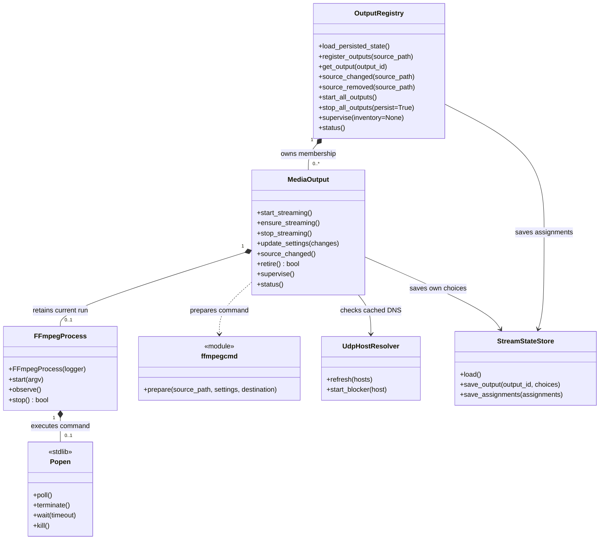
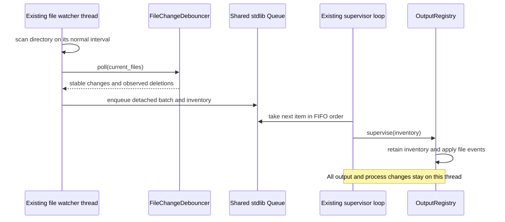
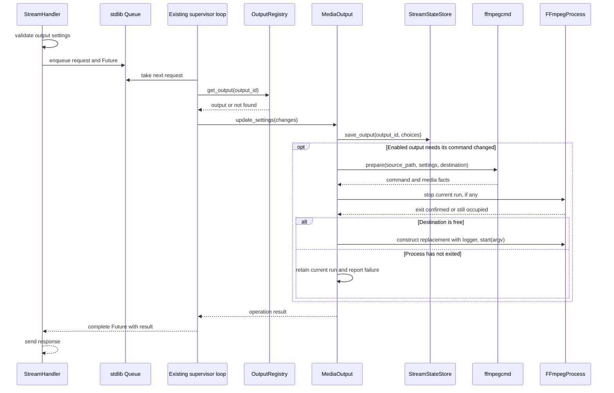
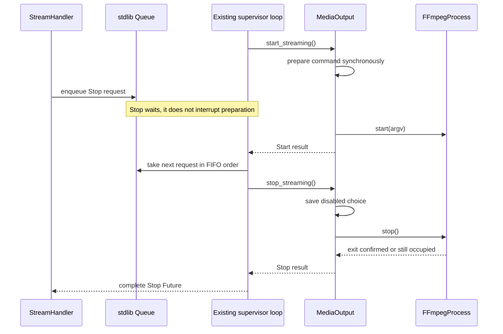

# Autostream: simplified responsibility-driven design

Status: implemented in the working tree after approval of the simplified plan.
The rejected concurrent lifecycle machinery has been replaced. Changes remain
uncommitted; the application container remains stopped. No live-state migration
or deployment has been performed. Validation and measured tradeoffs are recorded
in [the refactor measurements](refactor-metrics.md).

This document supersedes the concurrent lifecycle design previously recorded
here. [The argument-complexity plan](argument-complexity-plan.md) retains
historical alternatives and baseline measurements, not the current architecture.

## Central simplification

**The existing supervisor loop is the sole owner of process changes and saved
settings.** HTTP threads submit requests; the loop applies them sequentially.
One background thread runs the existing polling and stability checker and
submits file events to the same queue. Applying file events, settings edits,
starts, stops, recovery, and persistence all run on the supervisor thread.

Selected watcher approach: reuse `filewatch.py` in a background thread. Add no
watcher dependency and do not convert the application to `asyncio`.

Use `subprocess.Popen` for process status and termination. Keep a thin
`FFmpegProcess(logger)` wrapper only for the useful application behavior:
starting one command, capturing diagnostics, and bounded termination. Do not
build another process state machine around it.

Remove the machinery introduced to coordinate concurrent lifecycle operations:

- Per-output and registry lifecycle locks.
- Settings revision counters and registration generation tokens.
- Pending-start reservations and stale-completion checks.
- Custom process-state enums/strings and transition logic.
- Persistence revision arbitration and obsolete-writer rejection.
- Multiple retained run objects, pending replacement queues, and a retirement
  coordination protocol.

There is still ordinary application state: independent user settings, enabled
intent, finite-playback completion, crash history, and whether a source has been
removed. Each fact has one owner. Presentation labels such as “waiting” and
“completed” are derived descriptions, not a stored transition system.

## Responsibilities

The design continues to use the responsibility-driven approach discussed in
Rebecca Wirfs-Brock's [A Brief Tour of Responsibility-Driven
Design](https://www.wirfs-brock.com/PDFs/A_Brief-Tour-of-RDD.pdf). Classes need useful
behavior, not a separate wrapper for every piece of state.

| Collaborator | Responsibility |
|---|---|
| Existing supervisor loop | Execute requests and file events sequentially, schedule supervision, and publish status |
| Existing file watcher | Scan and check stability in one background thread; enqueue observations without accessing outputs or saved settings |
| MediaOutput | Control one delivery, own its settings and enabled choice, recognize completion, and decide recovery |
| OutputRegistry | Locate outputs, handle filename collisions, preserve UDP assignments, and perform collection operations |
| FFmpegProcess | Run one command using Popen, report its result and diagnostics, and perform bounded shutdown |
| ffmpegcmd functions | Probe media and prepare a command from explicit inputs |
| StreamStateStore | Load/migrate saved data and atomically save output choices or assignments, with one writer |
| UdpHostResolver | Share cached DNS answers across outputs, refreshed by the supervisor loop |
| StreamHandler and response functions | Validate HTTP input, submit requests, and serve published status and the UI |

Keep independent MediaOutput objects. There is no parent Stream, MediaSource,
StreamManager, settings controller, or persistent command-builder class.
Outputs may use the same source path without sharing mutable settings.

Mode, loop count, frame rate, GOP, bitrate choices, and destination-specific
choices belong to each output. Defaults initialize those choices. Application
infrastructure, such as the HTTP listening port and logging configuration,
remains application configuration. The UI may group outputs by source.

## One execution path

Use one standard-library `queue.Queue` between HTTP threads, the background file
watcher, and the existing loop.
A small function submitted by the handler performs lookup and invokes the
output's behavior when the loop executes it. A standard-library `Future` can
return the result to the waiting handler. Do not introduce command classes, a
command bus, a dispatcher registry, or another application controller.

The queued function captures the output identity and validated input, not a
reference to a live output. It calls `registry.get_output(output_id)` at execution
time, followed directly by the appropriate output method. Removed outputs are
not returned for new requests. This preserves direct behavioral collaboration
without exposing domain objects to HTTP threads.

Each loop iteration processes a bounded batch of queued HTTP requests and file
observations in FIFO order, supervises outputs, and publishes a detached status
document. Bounding the batch prevents continued incoming work from starving
process supervision. A full queue produces an explicit busy response for a new
HTTP request. The watcher waits for queue space, checking its shutdown signal
between attempts, rather than discarding observed changes or accumulating an
unbounded backlog. Within a scan's event batch, apply deletions before creations
and modifications so a rename can release an identity before claiming it again.

Only queue operations, request completion, and publication of the cached status
cross threads. If needed, use one short lock for replacing/reading the published
JSON document. HTTP GET never reads live domain objects or calls their methods.
No domain lock is held across probing, DNS, subprocess operations, or disk writes
because domain objects have only one calling thread.

### Background scanning and stability

The watcher owns its scan interval and FileChangeDebouncer. A scan is synchronous
on that thread. Stability is checked across successive scans; the watcher does
not wait inside a scan for a file to finish copying.

- Preserve the existing polling behavior and size/modification-time stability
  check. Files already present at startup go through that same check.
- Enqueue stable creations/modifications and observed deletions. A failed scan
  is not an empty directory and must not emit deletions for unreadable files.
- Transfer detached event batches and the last successfully observed inventory;
  the registry keeps the received copy for discovery and port-allocation
  decisions. Distinguish present files from files that have passed stability.
  This also lets it retry registration after cleanup without asking the watcher
  to repeat a creation event or scanning the directory itself.
- Pass observations as data, never callbacks that access live outputs from the
  watcher thread. Only the supervisor resolves identities and invokes behavior.
- Start the watcher once at application startup. Use a standard-library Event
  for shutdown and interruptible waits between scans. Report unexpected watcher
  failure; do not silently continue as though discovery were still functioning.

A file may change again between observation and handling. Events report an
observation, not a guarantee of the file's current contents; a missing source
must not cause a new launch. Later scans provide subsequent changes. No file
generation tokens or concurrent process operations are introduced.

The extra thread isolates slow directory scans from process supervision. A slow
filesystem can still delay discovery, and a stuck filesystem call may outlast a
shutdown join timeout. Keep this limited threading tradeoff explicit.

### Deliberate responsiveness tradeoff

A synchronous probe, launch, or bounded shutdown delays later commands and the
next status publication. HTTP can continue serving the last published snapshot.
A Stop received during preparation waits in the queue. The earlier Start may
finish and briefly run before Stop executes. **Stop is not an immediate
cancellation of work already in progress.**

The handler reports operation success only after the loop finishes that request.
A disconnected or timed-out HTTP client does not cancel queued or executing work;
its outcome may be unknown to that client. The UI must not automatically retry
mutations. Do not add operation tracking or cancellation infrastructure to hide
this tradeoff.

Keep the existing probe timeout and bounded terminate/wait/kill sequence. DNS
refresh belongs in the loop, never in HTTP handling; a slow system resolver can
also delay supervision. If measured delays later become unacceptable, revisit
that specific blocking operation rather than preemptively rebuilding concurrent
lifecycle coordination.

## Classes and public interfaces

These retain the agreed behavioral names. The loop is existing composition code,
not a new class. Queue, Future, Thread, and Event are standard-library
collaborators. FileChangeDebouncer remains confined to the watcher thread.

`supervise(inventory=None)` accepts a detached watcher batch when one is
available, or performs an ordinary tick. `stop_all_outputs(persist=False)` is
used only for application shutdown so stopping child processes does not save a
user Stop. The registry retains the latest received inventory for allocation
and rediscovery; it does not scan the directory.

All domain methods above run on the supervisor thread. Returned status and probe
values are detached data. `MediaProbeResult` and `FFmpegCommandSettings` remain
immutable command-preparation records, not behavioral services.

| Interface | Simplified contract |
|---|---|
| Registry registration and lookup | Validate identity, reject filename collisions, restore choices, assign a port, and return eligible behavioral outputs |
| Registry file events | Notify outputs of a changed source; retain removed membership until its processes can stop |
| Registry Start All / Stop All | Invoke output behavior for each present source; never synchronize settings |
| Registry supervise | Supervise present outputs and retry cleanup of removed ones; do not infer process state from private fields |
| Registry status | Collect detached descriptions for publication by the loop |
| Output start_streaming | Enable and explicitly start/restart this delivery |
| Output ensure_streaming | Enable an absent delivery; preserve an existing run for Start All |
| Output stop_streaming | Disable delivery, save that choice, and stop the current process; attempt the stop even if saving fails |
| Output update_settings | Save an edit for this output; restart its current run if appropriate; leave a disabled output disabled |
| Output source_changed | Refresh preparation and clear finite completion; preserve its settings and enabled choice |
| Output retire | Attempt to stop its process without saving a user Stop; return whether its destination is free |
| Output supervise | Check the current run, recognize finite completion, and recover only when its enabled choice permits |
| Output status | Describe requested settings and the actual command using current facts; do no probing, DNS, persistence, or waiting |
| Process start | Use Popen once for this run; no starting/reserved/cancelled state model |
| Process observe | Report poll result, exact argv, start time, and bounded diagnostics; no custom process-state field |
| Process stop | Terminate, wait, escalate to kill, and return whether exit was confirmed; retain a handle that has not exited |
| Store load/save | Load or migrate once, merge a scoped change, and replace the file atomically; no concurrent-writer protocol |
| Resolver refresh/start_blocker | Refresh shared DNS knowledge in the loop and answer from that cache; DNS success does not establish receiver health |

## Sequences

### A file becomes stable

### Apply settings to one output

A missing output ends the request with not found. A failed save or preparation
is reported, not presented as success. No other delivery changes. There is no
revision recheck because no other lifecycle request executes in the middle of
this one. If saved settings cannot be applied because stopping fails, retain
and report both the requested settings and the command still occupying the
output. Do not claim that the new settings are running.

### Stop received during preparation

Once Stop has executed, supervision does not restart that disabled output.
There is no concurrent late launch to cancel or reclaim.

### Removed source with a process that will not stop

1. Registry records that the source was removed and excludes its outputs from
   new commands, Start All, and recovery.
2. Registry asks each affected output to `retire()`.
3. If a stop fails, keep that output and its assignment in the registry. A single
   removed-membership marker is enough; the output does not also store retirement
   state. Retry cleanup on later loop iterations.
4. Once all affected processes have exited, remove those outputs and retain the
   saved filename, choices, and port under the existing reclamation policy.
5. A returned file or colliding replacement cannot claim that identity while it
   remains occupied. Reconcile the latest stable-file inventory received from
   the watcher after cleanup, so a returned file can be registered without a
   pending-replacement queue or another directory scan in the supervisor.

The registry asks for behavior and receives a boolean result. It never traverses
an output to inspect a Popen handle. There are no outstanding domain references
held by HTTP threads, generation checks, or retirement callbacks.

## Process behavior and diagnostics

`Popen.poll()` is authoritative for whether a child has exited. The process
wrapper owns its handle and the command it launched. MediaOutput owns enabled
intent, finite completion, and cross-run crash history. Do not store duplicate
running/stopping flags in the registry, output, and process wrapper.

Only one process may occupy an output. A failed bounded stop retains that
process and blocks replacement and port reuse. Later supervision can observe
its eventual exit. Recovery uses the output's then-current settings; successful
finite playback is recognized from the command that actually ran. Preserve the
existing stable-run interval for clearing crash history.

Keep logger injection. Configure handlers outside FFmpegProcess; the process
class never discovers a path by inspecting logger handlers or closes the
borrowed logger.

Use file-backed stdout/stderr capture without a pipe-draining worker thread.
The child writes directly to its capture file; normal loop observation can read
new diagnostic bytes and send them through the injected logger. Bound each read
and the in-memory diagnostic tail, and close the run's capture file after exit
and final diagnostic handling. Preserve useful per-output logs; debug forwarding
may lag behind the child. Capture uses an anonymous temporary file closed after exit. Each observation
forwards at most 64 KiB and retains a 4 KiB tail; a larger backlog is skipped
with a notice. Per-output logs rotate at 2 MB with one backup. The temporary
capture file can grow for the lifetime of a run; a bounded memory tail does not
bound that disk usage.

Do not recreate asynchronous observation callbacks or a reader shutdown protocol.
Normal child execution is asynchronous in the operating system; application
control and diagnostic observation remain sequential.

## Persistence, UI, and API

StreamStateStore has one writer: the supervisor loop. MediaOutput saves its own
choices directly; OutputRegistry saves assignments. The store merges those
scoped changes into its loaded document and atomically replaces the JSON file.
Write order is execution order. No revisions, epochs, generations, write locks,
or stale-write arbitration are needed.

Persist only durable settings and assignments, not process handles or queued
requests. Report storage failures. A Stop still attempts process termination if
saving fails, and the response must say the stopped choice was not saved.

Migrate the old source-wide settings into independent RTSP and UDP records,
preserving each enabled flag, source filename, removal information, and stable
UDP assignment. Back up the old file and validate the migrated document before
replacing it. Migration occurs only when the application starts with an old-format state file.

Each output gets its own settings and Apply/Cancel controls. Retain explicit
Start All and Stop All. Address an individual output with an identity such as
`source-name/rtsp`; lookup returns behavior, not settings for outside mutation.

Use the output-specific route shape already discussed:
`/api/streams/{name}/outputs/{protocol}/{start|stop|settings}`. The source-wide
settings endpoint must explicitly reject the old operation and direct callers
to an output; it must not silently apply an edit to both outputs. Grouped status
may remain at `/api/streams`, with settings inside each output. The HTTP layer
serves the loop's published snapshot rather than walking live objects.

## Files

| File | Responsibility |
|---|---|
| mediaoutput.py | One delivery's settings, start/stop behavior, completion, and recovery |
| outputregistry.py | Lookup, registration, collisions, UDP assignments, removal, and collection operations |
| ffmpegprocess.py | Thin Popen wrapper, bounded stop, and file-backed diagnostics |
| ffmpegcmd.py | Probe and command-preparation functions and immutable value records |
| statefile.py | Single-writer persistence, migration, and atomic file replacement |
| udphost.py | Shared DNS cache, refreshed by the loop |
| streamapi.py | HTTP validation, queued requests, replies, and published-status access |
| streamresponses.py | Format detached output descriptions, optionally grouped by source |
| stream_supervisor.py | Compose collaborators, start/stop the watcher thread, and run the loop consuming requests and file events |
| filewatch.py | Existing polling and stability checker, confined to one background thread that submits detached observations |
| appconfig.py | Startup configuration validation |

No new queue, command, lifecycle, state-machine, or controller module is needed.
Keep `socket_memory.py` as the existing diagnostic. Module count is a consequence
of useful responsibilities, not a target.

Supporting public types remain Config with `from_env()`, FileChangeDebouncer
with `poll(current_files)`, StreamHandler with its HTTP framework callbacks,
and OneLineFormatter with `format(record)`. Do not invent extra public types for
request envelopes, lifecycle observations, or persistence ordering.

## Metrics and validation

Retain the requested argument scoring: a scalar costs 1; dictionary keys cost
1 each up to 5; each stored field of a passed class counts; a homogeneous
collection costs 1. Continue to identify the provisional conventions of
one-level expansion and excluding implicit `self`.

Count the entire interaction, including queue submission, captured inputs,
lookup, constructors, persistence, command preparation, and process calls. A
closure is not a one-point shortcut for hiding its captured dependencies. Report
receiver field counts separately and identify opaque standard-library objects
rather than assigning them an invented one-point cost.

Expected effects, pending measurement:

| Measure | Expected change from the rejected concurrent draft |
|---|---|
| Stored coordination state | Lower: remove revisions, generations, reservations, and duplicate lifecycle state |
| Cyclomatic complexity | Lower in lifecycle/persistence code; queue handling adds a small amount of transport code |
| Cohesion | Clearer ownership of delivery behavior, membership, subprocess work, and persistence; numerical improvement is not guaranteed |
| Coupling | Fewer lifecycle synchronization contracts; HTTP and the watcher communicate through the queue rather than accessing live domain objects |
| Argument score | Ordering metadata disappears, but queue inputs and captured dependencies still count; calculate actual totals after implementation |
| Responsiveness | Directory scans run independently; commands and status updates still wait behind slow lifecycle operations |

The watcher adds one producer thread and its shutdown signal. Count its queue
payloads and inventory transfer in the argument metrics. This is a deliberate
cost to isolate directory I/O, not a return to concurrent lifecycle mutation.

Do not reuse earlier projected totals. Compare the eventual simplified code with
both the pre-refactor baseline and the rejected draft, and label those baselines
clearly. Run the existing cohesion, coupling, and complexity tools after code
has actually been simplified. This plan does not claim measured improvements.

Focused acceptance scenarios:

1. RTSP and UDP settings remain independent, including saved round trips.
2. Two HTTP mutations execute in FIFO order. Stop queued during preparation runs
   afterward and leaves the output disabled; it need not prevent a brief start.
3. HTTP reports completion only after execution; GET serves a detached snapshot
   without probing, resolving DNS, or waiting for a process.
4. A failed stop retains the process and its port; removal prevents recovery and
   safe cleanup eventually permits rediscovery.
5. Finite completion, explicit Stop, crash recovery, and stable-run history reset
   still work without a custom process-state model.
6. Collisions, undiscovered startup files, file replacement, and retained UDP
   assignments preserve the established allocation behavior.
7. Migration preserves settings and assignments; atomic save failure is reported
   without corrupting the previous document.
8. Equivalent media choices produce equivalent commands. Status distinguishes
   requested choices from the actual command when an apply cannot finish.
9. Diagnostic capture does not block a child's pipe, allocate an unbounded line,
   require a reader thread, or prevent bounded shutdown.
10. The watcher holds growing files until stable, handles startup files, and
    delivers deletions without interpreting scan errors as disappearance. Slow
    scans do not block supervisor work; full queues do not silently lose events.
11. A file that returns while its old process is still stopping can be registered
    from a later received stable inventory after cleanup. The watcher never
    accesses output objects, subprocesses, or persistence.

Prefer these behavioral checks over tests of internal transition machinery.

## Implementation record

- Preserved pre-refactor and rejected-draft snapshots under
  `.generated/rdd-refactor/` for comparison.
- Routed HTTP operations and background watcher observations through one bounded
  Queue, with the supervisor as the only consumer. Published status is detached.
- Removed lifecycle locks, revisions, generations, start reservations, and the
  custom process-state record. Retained independent settings and port ownership.
- Implemented single-writer migration/persistence and a thin Popen wrapper with
  file-backed diagnostics and bounded stop.
- Updated per-output UI/API behavior and Docker's module-copy list. Validation
  covers queued execution, watcher stability, migration, process cleanup, command
  equivalence, real local UDP output, and independent settings in the browser.
- Corrected Mermaid participant identifiers and message punctuation; all four
  diagrams parse and render with Mermaid 12.2.0.

The application image has not been rebuilt or deployed by this refactor. Live
state and the stopped application container have not been changed.
